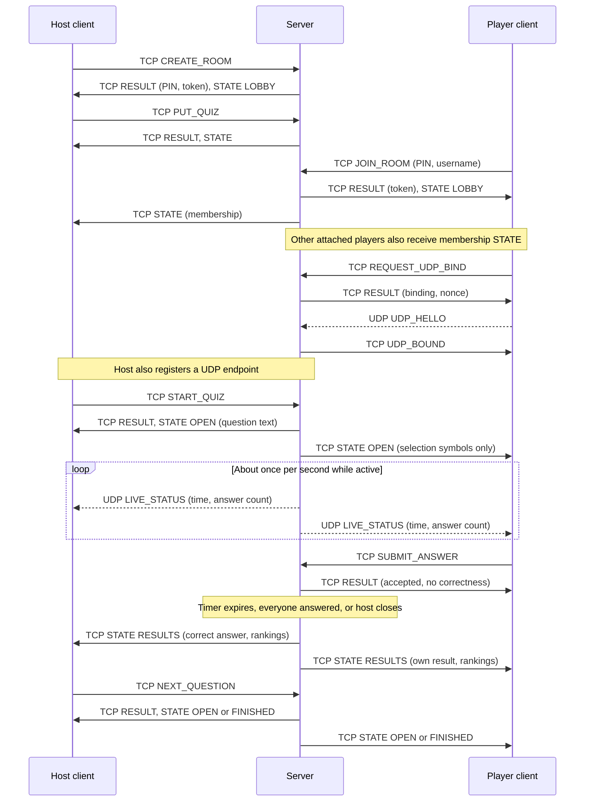
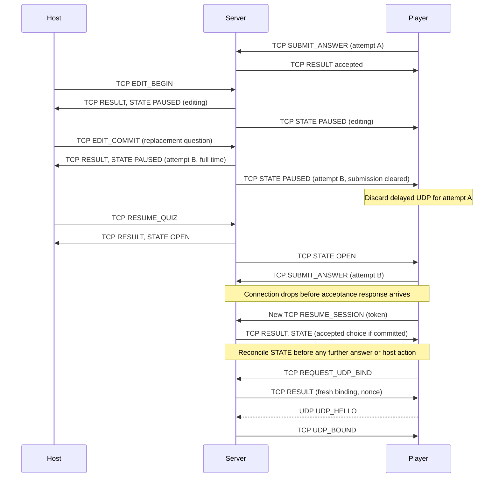

# Fat-Rat Application-Layer Protocol

Status: design specification v7, 2026-11-05. Four completed Claude reviews cover v5 core, scope extensions and report text; a fifth focused review covers the v6 team limits and a sixth covers v7 host ownership, closure and report text; Codex assessed findings and applied final corrections; see [protocol-review.md](protocol-review.md). Not implemented or network-tested. Agreed gameplay is recorded in [gameplay-decisions.md](gameplay-decisions.md); timer/question/name limits and departure/replay policies were approved by Abdallah. Remaining transport safety bounds are engineering defaults, not instructor requirements; the team has selected 5-50 players excluding the host, 2-8 choices and 1-30 questions; cheese artwork is an implementation detail. Saved-device host identity, one-room ownership and explicit closure are fully specified below. This is the detailed working specification; it can later be condensed into the report.

## 2.1 Architecture and transport selection

One Python server owns all rooms and authoritative membership, question attempts, deadlines, accepted answers and scores. The host is a privileged client, not necessarily the server device. Each client uses one persistent AF_INET (IPv4) TCP connection and one AF_INET UDP socket. Resolve the server to one IPv4 address and use that exact address for both transports, including local tests; do not mix loopback TCP with LAN-address UDP. Configurable example ports: TCP 43000, UDP 43001. Configure one advertised server IPv4 address and bind the server UDP socket to that address so replies have the expected source; TCP may listen on all interfaces. All clients, including those on the server machine, use that advertised address. For loopback-only testing configure 127.0.0.1 for both. A multi-homed/VPN server must explicitly select its reachable LAN address. Clients use the server's LAN address; no HTTP, WebSocket, networking framework, Internet deployment or NAT traversal is required.

TCP carries every command that can alter a room and every reliable response/state transition. UDP carries periodic, replaceable snapshots of remaining time and answered count. Losing UDP may degrade the live display, but cannot change answers, scores, phase or membership. In normal operation live updates use UDP; they are not duplicated as a per-second TCP stream. TCP state synchronization is an exceptional recovery path.

| Message category | Transport | Reason |
|---|---|---|
| Room creation/join, token-based reconnect | TCP | Identity and membership need acknowledged, ordered exchanges. |
| Quiz loading, question edits, host controls | TCP | Partial/lost commands must not create inconsistent quiz state. |
| Question setup and phase changes | TCP | All clients must know which attempt is open or paused. |
| Answer submission and its acceptance/error response | TCP | An answer affects scoring; no application-level UDP retransmission system is needed. |
| Results, rankings, state recovery, removal | TCP | Authoritative outcomes and privileges require reliable communication. |
| Heartbeat ping/pong | TCP | Detect stalled connections without treating ordinary UDP loss as player/host departure. |
| UDP endpoint registration | TCP challenge, UDP proof, TCP confirmation | Associates the observed UDP endpoint with an established client session. |
| Countdown and live answered count | UDP | Every full snapshot supersedes older ones; retransmitting an obsolete tick is unnecessary. |

This is a property-based justification, not a claim that UDP is always faster or necessary for a quiz. Instructor acceptance of this particular meaningful UDP use should be confirmed if needed.

### Team-selected room rules

Each room has one noncompeting host and at most 50 ACTIVE players excluding that host; LOBBY may contain zero players, and departures may reduce a running room below five. The start gate is five connected ACTIVE players; once started, departures below five do not stop the quiz. Count disconnected ACTIVE players against 50 because they retain reconnect rights; LEFT/REMOVED identities keep historical scores but free an active slot. A resume reattaches an existing identity and cannot consume a second slot. Serialize join/count checks under the room lock to prevent concurrent joins exceeding 50. Each host may own one unfinished room at a time; multiple simultaneous rooms require separate hosts. Confirmed 2026-11-05: use a saved host identity on the device without accounts. Finishing or explicitly closing a room permits another; reconnect returns to the same unfinished room and disconnect alone does not release ownership. Recognizing a person across devices is not promised. The saved credential and ownership rules are defined next.

### Saved host identity and successive rooms

Before the first CREATE_ROOM, the client generates 32 cryptographically random bytes, encodes them as unpadded URL-safe Base64 (43 characters), and saves this `host_token` locally for that server address and TCP port. Persist it and the pending creation request ID/username before sending; retain that pending request until its room ID is known. It represents a device profile, not an authenticated person. Reuse it for later rooms; clearing the profile or using another device creates another identity. The server must not identify hosts by display name or IP address. Tokens never appear in shared displays, quiz JSON, logs or UDP.

CREATE_ROOM includes `{username, host_token}`. Require a canonical 43-character unpadded URL-safe Base64 string decoding to exactly 32 bytes; malformed host_token in CREATE_ROOM or reconnect_token in RESUME_SESSION returns nonfatal INVALID_MESSAGE without registration or echoing the token. Require exactly 43 characters from [A-Za-z0-9_-], decoding to 32 bytes and re-encoding identically. A well-formed resume token not authorized for that room returns generic INVALID_TOKEN. Validate request schema and reject an attached socket, then validate the host display name before ledger/ownership checks. The server indexes the credential by SHA-256 of its decoded bytes and atomically allows at most one unfinished room per credential. LOBBY, OPEN, PAUSED and RESULTS occupy that slot. FINISHED does not. If occupied, return HOST_HAS_ROOM with `existing_room_id`; the client calls RESUME_SESSION using that room ID and its saved host_token, which is also the host's reconnect_token. Player reconnect tokens remain individually server-issued and room-scoped. Host actor_id is room-specific; the device credential can authenticate only that credential's HOST actor in each retained room, never a player. An attached socket cannot create/join/resume again; detach it and use a new connection when starting the next room.

Record each successful CREATE_ROOM request ID, its canonical request fingerprint and created room ID with that host record until shutdown. An exact retry returns ROOM_ALREADY_CREATED with `existing_room_id`, without creating a second room or returning an obsolete session_id; use RESUME_SESSION to attach. Reusing that creation ID with different content returns REQUEST_ID_REUSED. Check the creation ledger before current ownership; only after those checks evaluate fresh room/PIN resource allocation, so SERVER_BUSY cannot block lost-creation recovery. A new request ID with an occupied slot returns HOST_HAS_ROOM. Thus a delayed duplicate cannot unexpectedly create another room after the original has finished. CREATE_ROOM is the explicit exception to reconcile-before-retry: after an uncertain reply, open a new connection and resend the exact saved request with its original request_id and username. Use existing_room_id from ROOM_ALREADY_CREATED or HOST_HAS_ROOM for RESUME_SESSION. Do not use a fresh creation ID merely to recover an uncertain creation. Host recovery does not depend on receiving the initial RESULT, because the credential was saved before creation. Unknown/lost host credentials cannot be restored by name.

Natural completion through the final NEXT_QUESTION sets FINISHED with `finish_reason:COMPLETED` and releases ownership. The confirmed host action CLOSE_ROOM is allowed in any phase. Apply any independently overdue timeout before the expected_control_rev check: the question closes and scores normally, advances control_rev, and that old-revision CLOSE_ROOM returns STALE_STATE plus fresh RESULTS STATE without finishing the room. The client may reconcile and issue a fresh close request under the existing confirmation. When the revision check passes, discard any still-unclosed attempt and edit transaction without scoring them, preserve all previously awarded scores and last closed result, freeze the final leaderboard and set FINISHED with `finish_reason:HOST_CLOSED`. On this early-closure path set current_question and question_index to null, submitted_choice_id to null, remaining_ms to zero, editing=false and pause_reason=null; freeze question_count at its value on closure. No new QuestionResult is made for the discarded attempt. Existing ACTIVE identities can reconnect to read the final state, and future reusable-quiz edits cannot change it. After authentication and the expected_control_rev check, CLOSE_ROOM on an already FINISHED room is a successful no-op preserving the first finish_reason and ranking; RESULT only, no STATE, revision change or cache entry. Normal completed-room history remains unchanged. No new game starts in a retained room.

A successful phase-changing CLOSE_ROOM returns RESULT then reliable per-recipient STATE; no new terminal event or token revocation is required. The UI confirms ending the room and warns that an unclosed question will not score. If its response is lost, resume and inspect phase/finish_reason before any further action. Disconnection alone never releases ownership. A host who returns to an abandoned lobby or paused room can resume and explicitly close it. Retain the finished room/history until shutdown while permitting a fresh room with the saved host credential. On server restart, in-memory rooms, creation ledger and ownership end; the saved host credential may register a fresh room again.

Use a registry lock for room lookup/allocation, the per-host creation ledger and ownership map. CREATE_ROOM holds it for atomic check-and-create. NEXT_QUESTION and CLOSE_ROOM acquire registry lock then room lock for the whole phase/ownership commit; never acquire registry while holding a room lock. Other handlers/timers use only the room lock after a short registry lookup has released the registry lock. Only final NEXT_QUESTION or CLOSE_ROOM releases ownership; conditional release must match the room being finished so a late action on an old room cannot clear a newer room's slot. Socket I/O stays outside both locks. Concurrent create/finish/close follows this common order.

## 2.2 Encoding, framing and common types

### TCP framing

Each message is `uint32_be(N) || N bytes of UTF-8 JSON`. N is the encoded byte length, excluding the four-byte header. N must be 1..1,048,576 (1 MiB); lengths outside this range close only the offending connection. An exact-read loop collects four header bytes and then N payload bytes. It must handle fragmented headers/bodies and consecutive frames without discarding bytes. Sending uses `sendall` through one ordered writer per connection. EOF, including mid-frame EOF, is a disconnect. A partially received frame times out after 10 seconds from its first byte (proposed limit), independently of idle-connection heartbeats.

Encode JSON using UTF-8, `ensure_ascii=False` and compact separators. Only objects are allowed; reject duplicate keys and NaN/Infinity. Booleans do not count as integers. Fatal input errors: invalid frame length, incomplete-frame timeout, invalid UTF-8/JSON, duplicate keys, nonfinite numbers, non-object payload or unsupported version. Send a bounded ERROR if safe, then close only that connection; invalid lengths can be closed without a reply. Nonfatal errors in otherwise well-formed JSON objects (unknown message/fields, missing fields, wrong types/ranges, invalid commands) receive a correlated ERROR when a usable request ID exists, otherwise `reply_to:null`. Unknown versions use UNSUPPORTED_VERSION; other parse/schema failures use INVALID_MESSAGE. Frame bytes are never scanned for a guessed replacement boundary. Clients ignore unknown server extension fields but ignore/log an unknown server message type or response to an unknown request; malformed server framing/JSON disconnects the client.

### UDP framing

One complete UTF-8 JSON object per datagram, no length prefix. Maximum payload 512 bytes (a conservative IPv4 LAN draft limit). Oversized, truncated, malformed or unexpected datagrams are silently dropped. No answers, quiz text, full leaderboards or reconnect secrets go over UDP. UDP sockets use `recvfrom` with enough buffer to detect a payload above the limit; do not parse a truncated prefix.

### Common envelope

All JSON messages contain `v: 1`, `type: string`, `data: object`. Fields below are additional top-level envelope fields:

| Kind | Required envelope fields |
|---|---|
| Client TCP request | `request_id` (UUID string); `room_id` for every request after create/join/resume. |
| RESULT or request ERROR | `reply_to` equal to the request UUID; `room_id` if a room is known. |
| STATE | `room_id`, `state_rev` (nonnegative integer). |
| PING / PONG | No request_id, reply_to or room_id; `data.ping_id` correlates the pair. |
| TCP session events | `room_id` if bound to a room; event-specific data below. |
| UDP_HELLO | `session_id`, `binding_id`; data includes nonce. |
| LIVE_STATUS | `room_id`, `session_id`, `binding_id`, `question_id`, `attempt_id`, `control_rev`, `seq`; data below. |

All IDs other than a PIN/token/nonce are opaque UUIDv4 strings. Host clients generate question/choice UUIDs; the server generates room, actor, session, attempt, binding and ping IDs. `player_id` equals `actor_id` for a player; host actor IDs never identify players. `session_id` identifies the current TCP attachment and changes on every successful resume; actor identity and reconnect token remain stable. Revisions, sequence numbers, counts, points and durations are nonnegative integers at most 2^63-1; resource exhaustion before wrap is an explicit server limit. pause/resume clocks use integer milliseconds internally. `room_id` is a unique internal UUID; PIN is a JSON string of exactly six ASCII digits, allowing leading zeros, unique among retained rooms. The host's display name is not a player username and does not reserve a player name. Player usernames are Unicode NFC-normalized and trimmed; duplicates compare by casefold within a room. Host display names and player usernames must each contain 1..32 Unicode code points after NFC normalization and trimming; otherwise INVALID_USERNAME. Host names do not reserve a player name. Other text-character limits also count Unicode code points. Approved policy: name reservation lasts through disconnection, voluntary leave and removal until server shutdown, preventing impersonation by reusing an old name.

`state_rev` orders reliable STATE snapshots and increases on serialized control, quiz, phase, membership and connection-status changes, not ticks or answer acceptance. A separate `control_rev` starts at zero and increases only for successful host mutations, automatic question close, or host-disconnect state changes that affect the active question. Joins, LEAVE_ROOM without an automatic close, player disconnect/reconnect and host reconnect alone do not increase control_rev. The in-room host mutations PUT_QUIZ, START_QUIZ, PAUSE_QUIZ, RESUME_QUIZ, CLOSE_QUESTION, NEXT_QUESTION, EDIT_BEGIN, EDIT_COMMIT, EDIT_CANCEL, EDIT_QUESTION, ADD_QUESTION, DELETE_QUESTION, REORDER_QUESTIONS REMOVE_PLAYER and CLOSE_ROOM use `expected_control_rev`, checked under the room lock. Mismatch returns STALE_STATE with current_control_rev, then a fresh STATE; the host must reconsider the action. This prevents an old command executing after a pause/resume cycle without making ordinary player connection churn invalidate host commands. LIVE_STATUS matches control_rev, not state_rev. Neither revision resets within a room.

Every active question attempt has an immutable Question snapshot, separate from the reusable quiz list. Future edits cannot mutate it; current EDIT_COMMIT replaces it with a new attempt. Historical question/choice IDs and results remain frozen even if reusable questions are edited after FINISHED.

### Question and result types

- `Question = {question_id, text, choices, correct_choice_id, time_limit_ms}`. `text`: string nonempty after trimming, proposed maximum 1000 characters. `choices`: ordered array of 2..8 `{choice_id, text}` objects, unique opaque choice IDs, text nonempty after trimming up to proposed 300 characters. Correct ID must identify exactly one choice. Approved time range: 1,000..300,000 ms. Quiz: 1..30 Questions with unique IDs, title nonempty after trimming up to 100 characters, and compact UTF-8 quiz content at most 524,288 bytes (512 KiB), inside the frame limit. Before PUT_QUIZ, EDIT_COMMIT, EDIT_QUESTION, ADD_QUESTION, DELETE_QUESTION, REORDER_QUESTIONS or a new join, enforce the quiz byte cap and conservatively verify that the largest host STATE/result serialization with this quiz/roster, frozen current attempt, private result and the single authoritative leaderboard fits 1 MiB. Quiz mutation exceeding either cap returns INVALID_QUIZ with no mutation; join exceeding the outgoing budget returns SERVER_BUSY with retryable=false. This check must include worst-case final score/rank widths, individual tie rows, participation labels, connected=false, all pause reasons, live counts and every optional field that later state transitions can introduce, not only the current lobby snapshot. This byte budget is an additional technical safety bound; it does not replace the 50-ACTIVE-player room cap.
- Selection symbols are assigned by ordered choice position `symbol_index` 0..7. Player setup sends `{choice_id, symbol_index}` only, not answer text. The host renderer uses the identical ordering. Positions map to eight distinct cheese-themed symbols; exact artwork remains open.
- `RankRow = {rank, score, players:[{player_id, username, participation}]}`. Descending total score, dense rank (next distinct score increments rank by one), tied players grouped on one row. Names sorted for stable presentation. participation is ACTIVE, LEFT or REMOVED. Disconnection leaves participation ACTIVE; connection status is separate. Participation is a player status; the host is always eligible for authenticated host requests and broadcasts while attached, and cannot leave/be removed through player operations. References to ACTIVE attachments include that attached host. All participants, including departures, retain final history under the approved score-retention policy. STATE.leaderboard is the only ranking; QuestionResult does not duplicate it. On FINISHED, freeze the final leaderboard including participation labels. Later token revocation/detachment changes live participant status but not this frozen final ranking.
- `QuestionResult = {question_id, attempt_id, correct_choice_id, reason, own_result}`. `reason`: `ALL_ANSWERED`, `TIMEOUT` or `HOST_CLOSED`. Player `own_result`: `{choice_id: id|null, correct: bool, points: int, total_score: int}`; host `own_result` is null. Correctness and points exist on the wire only for a closed attempt.

## 2.3 Message catalogue

H = host client, P = player client, C = either, S = server. Each row defines `data` fields; common envelope fields above are not repeated. All request responses are RESULT/ERROR. Mutating requests succeed atomically or have no effect. REMOVE_PLAYER and LEAVE_ROOM are valid in LOBBY, OPEN, PAUSED, RESULTS and FINISHED; neither is a host leave operation. For the requesting client, queue RESULT before the resulting STATE; all notifications are queued in committed room order. Replayed historical RESULT is an outcome acknowledgement, not permission to restore old state; clients reconcile the following fresh STATE. Only server STATE changes phase.

| Type | Direction | Transport | Data fields and meaning |
|---|---|---|---|
| CREATE_ROOM | H → S | TCP | `{username, host_token}`. Saved device credential; one unfinished room per credential. Exact previously successful request returns ROOM_ALREADY_CREATED; otherwise occupied ownership returns HOST_HAS_ROOM, both with data.existing_room_id and no envelope room_id (the socket remains unattached). New room is an empty LOBBY; RESULT returns identity fields below. |
| JOIN_ROOM | P → S | TCP | `{pin, username}`. Join LOBBY, OPEN, PAUSED or RESULTS; approved replay policy: reject new joins to FINISHED. Reject at 50 ACTIVE players with ROOM_FULL; disconnected ACTIVE players occupy a slot, LEFT/REMOVED history does not. RESULT returns identity; then role-filtered STATE. |
| RESUME_SESSION | C → S | TCP | `{room_id, reconnect_token}`. Authenticate retained identity; room_id is in data because connection is not yet attached. RESULT returns identity; then STATE. |
| PUT_QUIZ | H → S | TCP | `{expected_control_rev, title, questions:[Question]}`. Replace quiz atomically in LOBBY only; never starts it. Loading/saving local JSON is a client action; the host sends this validated quiz to S. |
| START_QUIZ | H → S | TCP | `{expected_control_rev}`. LOBBY with a valid loaded quiz and at least five connected ACTIVE players, excluding the host, → OPEN first question; missing quiz returns INVALID_STATE, insufficient players returns NOT_ENOUGH_PLAYERS. |
| SUBMIT_ANSWER | P → S | TCP | `{question_id, attempt_id, choice_id}`. No claimed elapsed time, score, username or player_id; identity comes from TCP session. RESULT `{accepted:true, question_id, attempt_id, choice_id}`; no correctness/points. |
| PAUSE_QUIZ | H → S | TCP | `{expected_control_rev}`. OPEN → PAUSED, reason MANUAL; retain submissions and remaining time. |
| RESUME_QUIZ | H → S | TCP | `{expected_control_rev}`. PAUSED → OPEN if no edit is active; use stored remaining time. Current edit commit already reset that stored time to the full limit. |
| CLOSE_QUESTION | H → S | TCP | `{expected_control_rev}`. OPEN or PAUSED not editing → RESULTS; score once; do not close while editing is active. |
| CLOSE_ROOM | H → S | TCP | `{expected_control_rev}`. Confirmed room termination from any phase; finish as HOST_CLOSED, discard unclosed attempt/edit without points, preserve completed scores and freeze ranking, release ownership. Revision is checked before no-op detection. Already FINISHED: RESULT `{}` only, unchanged revisions, no cache entry. Otherwise RESULT `{}` then STATE; a due timeout makes the old revision stale as specified in 2.1. |
| NEXT_QUESTION | H → S | TCP | `{expected_control_rev}`. RESULTS → next question OPEN, or FINISHED with finish_reason COMPLETED after final results, releasing host ownership. No skipping/reopening completed questions. |
| EDIT_BEGIN | H → S | TCP | `{expected_control_rev, question_id}`. Current uncompleted question only in OPEN/PAUSED; freeze if OPEN, mark editing active, preserve original content, submissions and frozen time. Not a content mutation yet. |
| EDIT_COMMIT | H → S | TCP | `{expected_control_rev, question:Question}`. During active current edit, same question ID; validate then replace atomically, new attempt ID, clear all submissions, full stored time, PAUSED with editing false. Host explicitly RESUME_QUIZ. Revalidate full quiz and outgoing message byte budgets before commit. |
| EDIT_CANCEL | H → S | TCP | `{expected_control_rev}`. End current editing without changing content, submissions or attempt; remain PAUSED with original frozen time; explicit resume. |
| EDIT_QUESTION | H → S | TCP | `{expected_control_rev, question:Question}`. Replace a future question in an active session; or any question in LOBBY/FINISHED. Same question ID and position. Completed question edit during active session → QUESTION_LOCKED. FINISHED edits do not change saved result snapshots. |
| ADD_QUESTION | H → S | TCP | `{expected_control_rev, question:Question, before_question_id:id or null}`. Insert a question whose ID is absent from the current quiz before an editable future target, or append if null. Active session: never insert at/before current or completed question; LOBBY/FINISHED: entire reusable list is editable. Limit remains 30. |
| DELETE_QUESTION | H → S | TCP | `{expected_control_rev, question_id}`. Delete only a future question during an active session; LOBBY/FINISHED may delete any reusable question. Keep at least one reusable question. Never alter the current attempt or historical results. |
| REORDER_QUESTIONS | H → S | TCP | `{expected_control_rev, question_ids:[id]}`. Complete ordered permutation of the editable suffix, or full reusable list in LOBBY/FINISHED. Reject missing/extra/duplicate IDs or inclusion of locked prefix. |
| REMOVE_PLAYER | H → S | TCP | `{expected_control_rev, player_id}`. Mark REMOVED, revoke token, preserve score/accepted answers and exclude from eligibility. Send best-effort REMOVED notice. Cannot target host. If already LEFT or REMOVED, successful no-op: RESULT only; preserve original participation/revocation reason and revisions. |
| LEAVE_ROOM | P → S | TCP | `{}`. Sent only after client confirms permanent departure. Atomically mark LEFT, revoke token, preserve score/accepted answers and exclude from eligibility. RESULT `{left:true}` then close the departing TCP connection. No notification delivery guarantee is required to enforce departure. |
| GET_STATE | C → S | TCP | `{}`. RESULT `{}` then a complete role-filtered STATE. Used on reconnect uncertainty, stale revisions or prolonged lost UDP. |
| REQUEST_UDP_BIND | C → S | TCP | `{}`. RESULT `{binding_id, udp_nonce, server_udp_port}`; replaces old binding. |
| UDP_HELLO | C → S | UDP | `{nonce}` plus session_id and binding_id envelope. S validates challenge and same IP as TCP peer, records observed source port, replies UDP_BOUND over TCP. |
| UDP_BOUND | S → C | TCP | `{binding_id}`. Confirms endpoint; only then send/apply LIVE_STATUS for this binding. |
| LIVE_STATUS | S → C | UDP | `{remaining_ms, answered_count, eligible_count}`. Counts for the current attempt, including unanswered disconnected participants. No choices/correctness/scores. |
| RESULT | S → C | TCP | Data specific to the request. Generic successful mutation: `{}`. Create/join/resume: `{room_id, pin, session_id, actor_id, role, reconnect_token}` where role is HOST/PLAYER. Host reconnect_token is its pre-saved host_token; players receive an individual server-issued credential, unchanged on resume. |
| ERROR | S → C | TCP | `{code, message, retryable}`; `reply_to` null only if no usable request ID. Error-specific fields in data: current_control_rev for STALE_STATE; required reason for SESSION_REVOKED; question_id/attempt_id/choice_id for ALREADY_ANSWERED; retry_after_ms for RATE_LIMITED or SERVER_BUSY; existing_room_id for HOST_HAS_ROOM or ROOM_ALREADY_CREATED. Never include tokens/correct answers. |
| STATE | S → C | TCP | Complete, role-filtered snapshot defined below. Sent after identity, GET_STATE and reliable room transitions, to recipients specified below. |
| PING | S → C | TCP | `{ping_id}` random UUID, one outstanding per connection. Send a new ping five seconds after the previous valid PONG (or attachment), only if none is outstanding. PONG deadline is 15 seconds after enqueue; slow writer queues are independently bounded. Respond immediately with matching PONG. |
| PONG | C → S | TCP | `{ping_id}` matches outstanding ping. Session event, not a request; no request_id/result. |
| REMOVED | S → P | TCP | `{reason:"HOST_REMOVED", message:string}`. Best-effort final notice followed by disconnect; removal is committed even if delivery fails. |
| SESSION_REPLACED | S → C | TCP | `{reason:"RECONNECTED_ELSEWHERE"}`. Best-effort notice to old connection after valid session resume replaces it. Receiving client stops automatic resume; another takeover requires explicit user action, avoiding reconnect loops. |

Every TCP catalogue entry has the transport justification of its category in 2.1. UDP_HELLO is a small endpoint proof, not a game command. LIVE_STATUS carries actual live UI state; optional GET_STATE recovery does not make it a redundant TCP tick stream.

### STATE data

Required fields: `{control_rev, phase, finish_reason, pause_reason, editing, host_connected, title, question_index, question_count, current_question, remaining_ms, self, leaderboard, last_result, live}`. STATE is filtered per recipient, not merely per role: self/own_result differ for each player. Never broadcast one player's serialized snapshot to other players.

- `finish_reason`: null unless FINISHED, then COMPLETED or HOST_CLOSED. It is frozen at the first finish; no later close/edit/departure changes it.
- `phase`: LOBBY, OPEN, PAUSED, RESULTS or FINISHED. `pause_reason`: null unless PAUSED; otherwise MANUAL, EDITING or HOST_DISCONNECTED. `editing` is boolean and true exactly when PAUSED with reason EDITING. `host_connected` is independent, so an edit and a host disconnection can coexist. EDIT_COMMIT and EDIT_CANCEL set MANUAL. A host disconnect during an existing pause preserves its reason/edit flag; OPEN becomes HOST_DISCONNECTED. Host resume attachment alone preserves reason; explicit RESUME_QUIZ clears it. `question_index` is zero-based or null before start/after HOST_CLOSED. In LOBBY, question_count is zero if no quiz is loaded, otherwise the loaded reusable question count. `remaining_ms` is zero when no live question. In RESULTS and FINISHED/COMPLETED, current_question refers to the last closed question. In FINISHED/HOST_CLOSED it is null for both host and player projections.
- `self`: `{actor_id, role, username, total_score, submitted_choice_id}`; score/choice are null for host. Submitted choice refers only to the current attempt, including restored accepted answer. It does not reveal correctness.
- Player `current_question`: null in LOBBY or after HOST_CLOSED termination; otherwise `{question_id, attempt_id, choices:[{choice_id,symbol_index}], time_limit_ms}`. No question text, answer text, future quiz or correct ID is sent to player clients in OPEN/PAUSED. Correct ID appears in last_result only after close.
- Host current_question uses the same attempt/choices/time fields as the player projection, with additional question `text` and choice `text`; correct ID remains in the privileged quiz. Host additional field `quiz:null` before a quiz is loaded, otherwise `quiz:{title, questions:[Question]}` plus `participants:[{player_id, username, connected, participation, total_score}]`. The shared presentation must hide the host editor/correct-answer metadata while displaying an open question. Host management data is privileged; it is never sent to player connections.
- `leaderboard`: the only authoritative RankRow array; clients render rankings from this field, never from last_result. It represents cumulative scores from completed questions, initially zero-score rows for all retained participants. During RESULTS new joins can add zero-score rows; after FINISHED the complete ranking, including the participant/rank/score set and participation labels, is frozen. Later departures change live participant metadata and token authorization only, not this ranking. `last_result`: QuestionResult or null; retained across later states for completed attempt only. Editing a new attempt cannot reveal that new attempt's correctness through this field.
- STATE is sent for phase, editing/content, membership and connection transitions, not each accepted answer. Acceptance replies are private to the submitting player; UDP provides live counts. `live` is always present: null in ordinary STATE, or `{answered_count, eligible_count}` in a GET_STATE recovery snapshot for OPEN/PAUSED; null if there is no live attempt. Identity/resume STATE also includes that recovery snapshot when active.
- **Recipient rules:** any control_rev change or host_connected change sends a separately filtered STATE to the attached host and every attached player whose participation is ACTIVE. Join/removal/voluntary leave also sends STATE to every remaining ACTIVE attachment because the leaderboard roster changes; the joining client receives its RESULT before STATE, and the removed client instead receives best-effort REMOVED and the voluntarily leaving client its final RESULT. A player-only disconnect/reconnect sends STATE to the host and the reconnecting player (if present); other players need no connection-status-only update. GET_STATE replies only to its requester. All host mutations check expected_control_rev before no-op detection. Successful no-op commands send only their RESULT and have no revision change or replay-cache entry. STATE ordering rules apply within each live attachment.
- Snapshot and any private result are serialized from one committed room state. State revisions may jump; clients replace their snapshot, never wait for intermediate revisions. Equal revisions are permitted for GET_STATE/timing refresh; smaller revisions are ignored.

### Errors and validation order

| Code | Trigger / behavior |
|---|---|
| INVALID_PIN / INVALID_USERNAME / NAME_TAKEN | Join invalid room, invalid host/player name, or reserved normalized player name. Stay unauthenticated. |
| INVALID_MESSAGE / UNSUPPORTED_VERSION | Envelope/schema/encoding/version violation; fatal behavior follows framing rules. |
| INVALID_QUIZ / INVALID_CHOICE | Invalid question set or selected choice; no mutation/answer acceptance. |
| NOT_AUTHENTICATED / NOT_HOST / NOT_PLAYER | Missing session, player attempting host action, or host submitting an answer/LEAVE_ROOM; no mutation. |
| ALREADY_ATTACHED / UNKNOWN_PLAYER | New create/join/resume on an attached connection; or removal targeting unknown/host identity. No mutation. REMOVE_PLAYER targeting an already LEFT or REMOVED player succeeds as a no-op without caching, state/status change, new notice or revision increment. The first committed departure reason is permanent. |
| ROOM_MISMATCH / ROOM_FINISHED | Attached session targets another room, or new join to FINISHED. |
| INVALID_TOKEN / SESSION_REVOKED | Unknown room or unknown token returns INVALID_TOKEN with the same generic message (including after server restart); no identity restored; a retained revoked token returns SESSION_REVOKED with required data.reason HOST_REMOVED or LEFT_ROOM, and a human-readable message. Other ERROR types omit reason unless specified. This is a denial response, not a replacement token. |
| STALE_STATE / STALE_ATTEMPT | Revision mismatch or wrong question/attempt; server sends fresh private STATE after either error; inspect it before deciding next action. |
| HOST_HAS_ROOM / ROOM_ALREADY_CREATED | CREATE_ROOM with an occupied host slot, or exact retry of a successful creation ID. Include existing_room_id; client resumes that room using saved host_token. No new room. Changed content for a previously successful creation ID returns REQUEST_ID_REUSED. |
| ROOM_FULL / NOT_ENOUGH_PLAYERS | Join would exceed 50 ACTIVE players, or START_QUIZ has fewer than five connected ACTIVE players. Host is excluded. Existing-player resume does not consume another slot. No mutation. |
| INVALID_STATE / QUESTION_LOCKED | Action not allowed in current phase, no quiz, or mutation of current/completed prefix through future-only operation. Use EDIT_BEGIN to edit current content. |
| QUESTION_LIMIT / INVALID_ORDER | Add would exceed 30 questions or delete would leave an empty reusable quiz; or reorder is not an exact valid permutation. No mutation. |
| ALREADY_ANSWERED | Different request tries another submission after acceptance. |
| QUESTION_PAUSED / ANSWER_LATE | New answer while paused, or server deadline reached; reject. |
| REQUEST_ID_REUSED / RATE_LIMITED / SERVER_BUSY | Conflicting recent request ID, excess requests, or configured resource/capacity reached; no mutation. |

ERROR.retryable is true only for RATE_LIMITED and temporary SERVER_BUSY, with optional `retry_after_ms`; false for other codes. STALE_STATE/STALE_ATTEMPT/INVALID_STATE require inspecting fresh STATE rather than blind retry. ERROR.ALREADY_ANSWERED additionally includes `{question_id, attempt_id, choice_id}` containing that player's accepted choice. The relevant fields are inside data, including current_control_rev.

Validate the envelope/data schema without side effects; authenticate/derive identity and reject wrong room/role. Under the room lock, recheck the current connection-generation, expire any overdue attempt, handle replay as below, and perform the command checks/mutation atomically. Replay lookup/insertion is under the same synchronization, so simultaneous retries cannot both execute. SUBMIT_ANSWER order: match current attempt (or most recently closed attempt); matching closed attempt in RESULTS/FINISHED returns ANSWER_LATE, older/nonmatching attempt returns STALE_ATTEMPT. In PAUSED return QUESTION_PAUSED. In OPEN first enforce `remaining_ms > 0`, then validate choice and absence of an accepted answer; same original accepted request is handled by replay first. A new late duplicate therefore returns ANSWER_LATE. A previous attempt while a newer attempt is OPEN/PAUSED returns STALE_ATTEMPT; ANSWER_LATE is reserved for the matching current closed attempt in RESULTS/FINISHED. Other phases return INVALID_STATE. Invalid choice returns INVALID_CHOICE; an additional valid submission returns ALREADY_ANSWERED. Never trust client scores/timestamps/actor IDs/roles. A second LEAVE_ROOM after departure is not an authenticated request; see departure recovery in 2.7.

For START_QUIZ, validate phase, then loaded quiz, then the five-connected-player gate. For JOIN_ROOM after valid request schema, validate PIN, reject FINISHED, normalize/validate name, reject NAME_TAKEN, check ROOM_FULL, then check outgoing budget. A permanent size-budget refusal may occur with fewer than 50 ACTIVE players after extensive retained departure history; show that the room cannot accept more participants and that a fresh room is needed. This is a technical bound distinct from the 50-ACTIVE-player design target.

## 2.4 Reliable request processing and concurrency contract

- Requests use a fresh UUID per logical action. The persisted identical CREATE_ROOM retry is the sole creation exception defined in 2.1. For other commands, correlate replies but never blindly retry after an uncertain connection failure: resume and reconcile fresh STATE first. Exact same-request SUBMIT_ANSWER replay for an ACTIVE identity returns its original acceptance even after pause/close, provided the retained accepted-answer record matches request ID/type/data; different request/content follows normal rejection rules. Store that request fingerprint and acceptance with the answer record for the room lifetime. Restarted/discarded attempts remain identifiable for replay; returning their historical acceptance never reactivates them, and is followed by fresh STATE.
- Answer and host-result fingerprints are keyed by (actor_id, request_id) and survive session replacement. For successful host mutations only, keep the last 32 request fingerprints and RESULTs per actor. A matching cached replay returns the original response followed by a fresh STATE. Reusing a cached ID with different content returns REQUEST_ID_REUSED. Eviction is safe because replayed original host commands still carry an older expected_control_rev, which can never pass after their successful mutation. Successful no-op REMOVE_PLAYER or CLOSE_ROOM has no cache entry. Clients must never intentionally reuse UUIDs for new logical actions.
- GET_STATE, REQUEST_UDP_BIND, JOIN_ROOM and RESUME_SESSION exchanges are not replay-cached; CREATE_ROOM uses its separate per-host creation ledger. Each successful response has fresh state/binding as appropriate. Never cache errors. Repeated identity creation/join on an attached connection returns ALREADY_ATTACHED; reconnect requires a new socket and valid token. A lost first player JOIN_ROOM response before the client receives any token cannot be recovered securely by username alone; the orphaned identity stays ACTIVE, disconnected and eligible until the host removes it, so its missing answer prevents ALL_ANSWERED early close. The name remains reserved until server shutdown; the player must rejoin under a different name if no token was received. A host with a lost create response can recover through its saved host_token and creation ledger; use the returned existing_room_id to resume. A host who loses the saved credential leaves an orphaned room until shutdown.
- Proposed request-rate bound: 10 TCP requests/second per attachment, excluding PONG. RATE_LIMITED has no side effects; obey retry_after_ms. GET_STATE recovery remains rate-limited but cannot be disabled by a full history cache, because no unbounded mutation-history quota exists.
- One room lock serializes deadline checks, commands, membership, answer validation/insertion, scoring and phase changes. Use `now_ms = time.monotonic_ns() // 1_000_000`. The authoritative acceptance instant is now_ms sampled in the serialized handler after acquiring the lock; kernel arrival/first-byte time and client timestamps do not qualify. This deliberately simple policy has small scheduling/network-latency effects; it is not claimed latency-neutral.
- Every serialized room handler first closes an OPEN attempt if its deadline is already reached, before other game mutations. The room timer also performs this transition under the same lock. Thus a delayed timer thread cannot admit a late answer or allow editing after expiry. `remaining_ms = max(0, deadline_ms - now_ms)`; deadline_ms <= now_ms is closed/late, even when a displayed countdown rounded up. After this transition, answer handling maps the matching closed attempt to ANSWER_LATE as defined in 2.3.
- No blocking socket operation under a room lock. Commit state and enqueue immutable events in order while locked, then write asynchronously. One writer queue per TCP connection prevents frame interleaving and event reordering. Bounded queues disconnect a slow client rather than block its room. Registry/ownership operations follow the registry-then-room lock order defined in 2.1; ordinary room handlers never acquire registry while holding a room lock. Departures, token revocation, future-list changes, replay validation and all-answered checks use the same room synchronization. Async callbacks for replaced/closed TCP attachments check connection generation before modifying room state.
- On question close through timeout, all-answered or CLOSE_QUESTION, atomically compute and award every score exactly once, freeze QuestionResult (no duplicate leaderboard), move to RESULTS and queue STATE for all clients. Awarding in SUBMIT_ANSWER would risk premature leakage/double awards; submissions only record choice and acceptance-time remaining_ms.
- `r = clamp(accepted_remaining_ms,0,L)` and `score = 500 + (1000*r + L) // (2*L)` with integer `L = time_limit_ms` for correct accepted answers, else zero. Sum completed-attempt scores only. Elapsed pauses never reduce score. Pause stores max(0,deadline_ms-now_ms); resume sets deadline_ms = now_ms + stored_remaining_ms; restart discards the old attempt and resets it fully.
- The UDP answered_count counts accepted submissions from eligible ACTIVE players only, so it never exceeds eligible_count. If a removed or voluntarily left player already submitted, preserve that accepted answer for scoring/history at normal close, but omit them from live counts (approved departure policy). In OPEN or PAUSED, eligible players include all joined ACTIVE players, including late joiners and disconnected players. After an acceptance or eligibility-changing join/removal/leave, proposed empty-room default: close early only if this set is nonempty and every member has an accepted answer. A disconnect alone must never reduce eligibility or trigger an early close. Recheck the nonempty all-answered condition on RESUME_QUIZ too, because removal or voluntary leave during PAUSED may have satisfied it; if so, close directly to RESULTS without a transient OPEN event. Joins/last-answer/timeout races follow room-lock order. New joins during RESULTS wait for next question.

## 2.5 Phases and editing

| Current phase | Action | New phase / effect |
|---|---|---|
| LOBBY | PUT_QUIZ, join, edit/add/delete/reorder | LOBBY, no timer. |
| LOBBY | START_QUIZ | OPEN first question, new attempt UUID, full timer. |
| OPEN | PAUSE_QUIZ | PAUSED; save remaining time, retain submissions. |
| OPEN/PAUSED | EDIT_BEGIN | PAUSED, editing=true; save remaining time/content/submissions. |
| PAUSED editing | EDIT_COMMIT | PAUSED, editing=false, pause_reason=MANUAL, new attempt UUID, clear submissions, full timer; no score for discarded attempt. |
| PAUSED editing | EDIT_CANCEL | PAUSED, editing=false, pause_reason=MANUAL, preserve original attempt/submissions/time. |
| PAUSED not editing | RESUME_QUIZ | OPEN with stored time, or directly RESULTS if nonempty all-answered holds. |
| OPEN | Deadline/all answered | RESULTS with immutable result. |
| OPEN/PAUSED not editing | CLOSE_QUESTION | RESULTS with accepted submissions scored, unanswered zero. |
| RESULTS | NEXT_QUESTION | OPEN next question or FINISHED with finish_reason=COMPLETED and release ownership when there is no next question. |
| Any unfinished phase | CLOSE_ROOM | FINISHED, finish_reason=HOST_CLOSED; discard still-unclosed attempt/edit, keep awarded points, freeze ranking, release host ownership. |
| FINISHED | CLOSE_ROOM | After revision check, RESULT only; original finish_reason/history remain frozen; no revision change or cache entry. |
| Any nonfinished phase | Host disconnect | OPEN freezes to PAUSED; LOBBY/RESULTS remain in place; existing PAUSED/edit transaction remains paused. Explicit resume needed after reconnect. |
| Active session | EDIT_QUESTION / ADD_QUESTION / DELETE_QUESTION / REORDER_QUESTIONS future | Same phase/current attempt; immutable protected prefix and valid editable suffix. Reliable revised STATE to all. |
| OPEN | REMOVE_PLAYER / LEAVE_ROOM | Preserve accepted answers/history, exclude departed identity from eligibility; close ALL_ANSWERED if remaining eligible set is nonempty and fully answered, otherwise keep timer. |
| PAUSED | REMOVE_PLAYER / LEAVE_ROOM | Stay paused; recheck all-answered on explicit resume. |
| LOBBY/RESULTS/FINISHED | REMOVE_PLAYER / LEAVE_ROOM | Same phase; revoke active identity and update participation/roster. FINISHED scores/ranks stay frozen. |
| Active session | Edit completed question | ERROR QUESTION_LOCKED; no change. |
| FINISHED | EDIT_QUESTION / ADD_QUESTION / DELETE_QUESTION / REORDER_QUESTIONS | Update reusable quiz content only; final scores/historical results unchanged. Approved replay policy: no new game in the same room; create a new room to replay. |

### Future-question mutations and frozen results

All future-list operations are serialized using expected_control_rev. In OPEN, PAUSED or RESULTS, let k be the index of the current/just-closed question: indices 0..k form the protected prefix and only indices k+1..end are editable. While EDIT_BEGIN is active the same prefix boundary applies; current content still requires EDIT_COMMIT. ADD's nonnull before_question_id must be in that suffix; null appends. DELETE must target a suffix ID. REORDER must contain every current suffix ID exactly once and no others; it cannot add/delete by omission. No quiz loaded returns INVALID_STATE. Unknown edit/add-position/delete ID returns INVALID_QUIZ; a known locked single-target add/delete/edit target returns QUESTION_LOCKED; any invalid reorder permutation returns INVALID_ORDER, even if it includes locked IDs. Exception: current-content EDIT_QUESTION returns INVALID_STATE (use EDIT_BEGIN) only in OPEN/PAUSED; in RESULTS that question is completed and returns QUESTION_LOCKED. EDIT_BEGIN/COMMIT wrong current ID returns STALE_ATTEMPT. A repeat EDIT_BEGIN or COMMIT/CANCEL without its required transaction returns INVALID_STATE.

Validate the entire candidate quiz, 1..30 count, unique IDs, content and outgoing byte budgets before committing any operation. Question IDs must be unique within the candidate quiz; a deleted future question may be re-added using its saved ID. attempt_id and revision checks, not a permanent retired-ID ban, protect stale answers and host actions. Failed requests leave both list and revision unchanged (apart from an independently due timeout). Every actual validated list change increments control_rev/state_rev and sends per-recipient STATE to all active attachments. Canonically identical reusable changes are no-ops under the replay/no-op rules. Neither existing submissions, the active timer/attempt nor awarded points change. NEXT_QUESTION chooses from the latest committed suffix: deleting the last future question makes the current question final; appending before NEXT makes it playable. At an edit/NEXT race, lock/revision ordering determines which request succeeds; the loser synchronizes instead of silently modifying a newly current question.

In LOBBY and FINISHED the entire reusable quiz list is editable, but a completed session's question_count, question_index, current_question, scores and last_result are frozen history; host quiz can differ from that history after FINISHED edits. Active-session STATE question_count tracks current protected prefix plus edited suffix. No question-count/history field is derived from mutable post-session quiz data. Replaying the edited quiz creates a new room.

EDIT_CANCEL remains paused by approved policy. Player LIVE_STATUS carries aggregate answered count; the agreed player UI may ignore that count. A HOST_DISCONNECTED pause is closable by its authenticated, reconnected host when editing=false. If host disconnect is detected after deadline, close the expired question first; do not retroactively pause it. A host reconnect during editing receives pending edit state and can commit/cancel. Transient local editor text not sent to the server is not recoverable; only EDIT_BEGIN's original question and committed edits are retained. Timer at zero may display "waiting for results"; client display never generates the authoritative close.

## 2.6 UDP registration, ordering and loss

1. After TCP identity, client requests REQUEST_UDP_BIND. S issues a fresh random binding_id and 128-bit nonce encoded as 32 lowercase hexadecimal characters, valid for 10 seconds; old binding is disabled. The reconnect token is never reused as this nonce.
2. Client sends UDP_HELLO from its listening UDP socket to S's UDP port. Server verifies session, nonce, binding_id and source IP equal to TCP peer IP, and records observed source IP/port. S queues UDP_BOUND over TCP before enabling the binding. Client discards all LIVE_STATUS until this confirmation, even if a UDP snapshot overtakes it. Repeated identical HELLO from the same endpoint is harmless and re-confirms; another port requires a fresh bind request.
3. Retry HELLO at most once per second until confirmation, up to five sends. If it fails, renew challenge over TCP with increasing backoff capped at 30 seconds. No unbounded UDP handshake flood. Nonmatching traffic gets no response.
4. LIVE_STATUS is unicast about once per second in OPEN and PAUSED. Read phase, IDs, control_rev, sequence, counts and time from one committed snapshot under the room lock; release it before sendto. In OPEN use max(0,deadline_ms-now_ms); in PAUSED use the stored frozen duration. Never assemble a packet from fields read on different sides of an edit/pause transition. In PAUSED remaining time is constant. Snapshot sequence increases within a binding, even across questions; rebind changes binding_id and resets sequence to 1; the client resets last accepted sequence to 0 on confirmation. Bound payload includes room/session/binding/question/attempt/control_rev and `seq`.
5. Client checks server source IP/port and current binding, exact room/question/attempt/control_rev agreement with last TCP STATE, and strictly increasing seq. Reject older, duplicate or future-revision snapshots. A future snapshot can arrive before TCP's corresponding transition; discard it and use the next one after STATE arrives. UDP never modifies phase or authoritative results.
6. Missing packets need no retransmission. Clients estimate countdown locally between snapshots and label it approximate when stale. A matching UDP snapshot corrects the estimate; sequence numbers order snapshots but cannot prove a packet was not delayed. Server deadline alone decides lateness. An estimate reaching zero blocks no server operation; client can show waiting and defer to server response.
7. Only in OPEN/PAUSED with a confirmed binding, after three seconds without a matching snapshot, mark live progress stale, do not invent answered counts, and request GET_STATE (at most once per five seconds). Rebind with backoff if loss persists. Outside OPEN/PAUSED no stale-UDP polling occurs. Do not mistake UDP silence for a TCP disconnect or auto-pause the room. In this fallback, TCP refreshes coarse timing/state, not an identical tick stream.
8. Stop updates when session is disconnected/replaced/removed/left or phase has no active question. Send only to registered ACTIVE session endpoints. Packet size/rate are bounded; if the TCP peer becomes unresponsive stop UDP and recover through TCP. No claim of Internet-grade congestion control for this LAN-only draft.

This session/nonce binding prevents accidental cross-session routing and casual unsolicited registration. It is not cryptographic protection from an on-path attacker: raw LAN sockets are unencrypted, so interception, spoofing and stronger identity remain outside scope. Reconnect tokens must not appear in shared display, logs or UDP packets.

## 2.7 Disconnections, replay and shutdown

- Server follows the PING schedule in 2.3 with one outstanding ping; missing its PONG for 15 seconds, EOF, reset or writer failure disconnects the session. Detecting a silent Wi-Fi drop is not instantaneous. TCP error/timeout is authoritative; missing UDP alone is not. Client also treats 20 seconds without any complete TCP frame as a stalled connection and attempts resume with exponential backoff (1, 2, 4, 8 seconds capped at 15); a valid frame resets that inactivity clock. Silent host failure can consume question time before detection; an expired question is not retroactively paused.
- Player identity/submissions/scores persist in server memory while its room exists. Client stores `{server_address, room_id, role, reconnect_token}` locally, separate from quiz JSON, and may resume from a new TCP connection. Player token is 32 server-generated cryptographically random bytes encoded as unpadded URL-safe Base64 (43 characters), scoped to one actor/room. The host uses its locally generated saved host_token as reconnect_token, authorized only for its own HOST actor in each retained room; it is not discarded when an old room ends. Invalid old-room resume stops that resume loop but does not delete the reusable host profile credential. Valid resume replaces old TCP/UDP binding, preserving logical actor; old connection's queued inbound commands must fail an internal connection-generation check. STATE is queued before any later live events for the new connection. Reconnect invalidates old UDP binding: request REQUEST_UDP_BIND and repeat HELLO/BOUND before applying new live updates.
- Proposed safe replacement rule: valid RESUME_SESSION for a host still marked connected first applies the host-disconnect rule under the lock (expire an overdue question first; otherwise OPEN freezes to PAUSED, incrementing control_rev), then installs the new attachment. This prevents a fast reconnect from bypassing the agreed explicit-resume behavior. An already paused or RESULTS/LOBBY/FINISHED room retains its phase. Notify all attached sessions of the final state even if host_connected ends true. Resume does not automatically resume gameplay after host loss. Disconnected unanswered players remain eligible; already accepted answers remain accepted. Correct answers are not leaked while recovering an open attempt.
- Host removal atomically sets participation=REMOVED and revokes the token before queuing REMOVED `{reason:"HOST_REMOVED", message:"You were removed from this quiz."}`. Invalidate UDP binding and pending inbound commands by session generation. Queue the terminal notice through the existing ordered writer, then close with a bounded flush; never interrupt a partially written frame to inject a notice. If delivery fails, removal still stands. Subsequent RESUME_SESSION with that retained token returns SESSION_REVOKED/HOST_REMOVED. Never issue a new "not accepted" token: the existing token is no longer authorized.
- REMOVE_PLAYER targeting an already LEFT or REMOVED player is a successful no-op, preserving the first departure cause. Voluntary LEAVE_ROOM is player-only and must follow a UI confirmation that returning under that identity will be unavailable. Commit participation=LEFT and revoke token before final RESULT `{left:true}`, clear UDP binding, then bounded-flush/close. If the final response is lost, a resume using the old token returns SESSION_REVOKED/LEFT_ROOM, letting the client identify that leave committed; do not replay it as a new join automatically. For player credentials, at successful leave/removal notification, SESSION_REVOKED or INVALID_TOKEN, discard the locally stored token and stop automatic resume attempts. If an uncertain LEAVE_ROOM is followed by a successful RESUME_SESSION, leave did not commit; the original user confirmation permits a fresh LEAVE_ROOM. Until {left:true} or SESSION_REVOKED is received, do not display confirmed departure or discard an otherwise valid token. If resume succeeds after an unacknowledged LEAVE_ROOM, the leave did not commit; the successful new attachment invalidates old queued commands. The client may resend LEAVE_ROOM with a fresh request_id under its already-given confirmation. A plain network drop or closing the app without this command remains an accidental disconnect and keeps eligibility/token; it is never interpreted as explicit leave.
- In both departures, preserve all earned points and current accepted submissions for normal scoring if that attempt closes; EDIT_COMMIT discards the entire attempt including departed players' submissions, without scoring any of it; unanswered departure earns zero for that attempt. Departed identities are excluded from this and future pending sets and keep final history, even if they departed in LOBBY. Remaining ACTIVE clients receive revised STATE; no departure with an empty eligible set auto-closes (engineering default). Host can still close manually; otherwise timer expires. Preserve reserved names; neither LEFT nor REMOVED tokens can be used for reconnect. Fresh joining under another name cannot be reliably prohibited without stronger identity.
- Authenticate and check participation/generation under the room lock before replaying any cached response; removal/leave must not be bypassed by replaying an earlier accepted command. In FINISHED, leave/removal still revoke tokens and detach, but never modify the frozen final leaderboard. A departing attachment can receive only queued prior frames and its terminal notification/response; it gets no later quiz states/results. After a departure commits, drop any queued inbound frames from that old attachment without creating new reply frames after its terminal message. Fresh reconnect sockets get the defined revoked-token ERROR. Closing an obsolete attachment must not detach its newer replacement.

- Engineering default for finished-room joins: reject new joins to FINISHED; retained ACTIVE participants may resume to see final results; LEFT/REMOVED tokens stay revoked. Quiz edits after FINISHED affect future reuse, not frozen session results. Approved retention: keep rooms until server shutdown, including a paused room whose host never returns; no automatic room expiry in this course version. The team-selected cap is 50 ACTIVE player identities excluding the host; capacity remains unverified until testing. On manual server stop, sockets close and all in-memory rooms/tokens end. Server crash recovery is not promised. On INVALID_TOKEN or SESSION_REVOKED the client stops automatic resume attempts and deletes the player room entry or stale host room attachment; it preserves the reusable host profile credential; an absent room after server restart returns INVALID_TOKEN, not an endless retry. TCP connection failures alone retain the saved token and use bounded backoff; user may stop retrying and discard it locally without issuing LEAVE_ROOM. Such local discard is not an authoritative departure.

## 2.8 Example exchanges

All examples show logical JSON; the TCP four-byte prefix is omitted. IDs here are readable placeholders; actual wire IDs must be UUID strings.

```json
{"v":1,"type":"SUBMIT_ANSWER","request_id":"request-uuid","room_id":"room-uuid","data":{"question_id":"question-uuid","attempt_id":"attempt-uuid","choice_id":"choice-uuid"}}
```

```json
{"v":1,"type":"RESULT","reply_to":"request-uuid","room_id":"room-uuid","data":{"accepted":true,"question_id":"question-uuid","attempt_id":"attempt-uuid","choice_id":"choice-uuid"}}
```

```json
{"v":1,"type":"LIVE_STATUS","room_id":"room-uuid","session_id":"session-uuid","binding_id":"binding-uuid","question_id":"question-uuid","attempt_id":"attempt-uuid","control_rev":12,"seq":8,"data":{"remaining_ms":12000,"answered_count":3,"eligible_count":5}}
```

### Typical session sequence



### Editing and reconnect ordering



### Removal notification and reconnect denial

```mermaid
sequenceDiagram
    participant H as Host
    participant S as Server
    participant P as Player
    H->>S: TCP REMOVE_PLAYER (expected_control_rev, player_id)
    Note over S: Commit REMOVED, revoke token, clear UDP binding
    S->>H: TCP RESULT, revised STATE
    S->>P: TCP REMOVED (HOST_REMOVED, message), then close
    Note over S,P: Notice is best-effort; revocation holds if it is lost
    P->>S: New TCP RESUME_SESSION (old token)
    S->>P: TCP ERROR (SESSION_REVOKED, reason HOST_REMOVED)
    Note over P: Display removal reason and discard local token
```

## 2.9 Requirement traceability and later verification

| Section 2 requirement | Covered here |
|---|---|
| Message purpose, fields, direction, transport | 2.2 types/envelope + 2.3 catalogue |
| TCP/UDP table with reasons | 2.1 table and per-message transport in 2.3 |
| Main exchange order | 2.5 transitions, 2.6 binding, 2.8 diagrams |
| TCP partial/multiple reads | 2.2 exact length-framing contract |
| Missing, invalid, unexpected messages | 2.2 parsing, 2.3 errors, 2.4 replay, 2.7 recovery |
| UDP loss/duplication/reordering | 2.6 snapshots, identity/revision/seq filters and stale fallback |
| At least one sequence diagram | 2.8 contains three Mermaid source diagrams |

Additional v6 boundary checks: four versus five connected ACTIVE players at start; disconnected players excluded from the start gate but occupying capacity; the 51st player rejected; simultaneous joins at 49; resume accepted at 50 without allocating a slot; leave/removal freeing an active slot while retaining history; choice counts 1/2/8/9 and question counts 0/1/30/31; a real 50-player load run and the outgoing-size boundary after many departures. Also test concurrent CREATE_ROOM under one saved credential, lost initial host RESULT, exact creation retry after finish, changed-content reuse, stale CLOSE_ROOM, close versus deadline/final NEXT, lost closure response and resume, ending while editing, finishing/closing then creating another room, and late old-room closure not releasing a newer ownership slot.

Future implementation verification must exercise split/coalesced frames, invalid/oversized data, duplicate answer/retry, late/pause/close races, editing vs stale answer/tick, lost/reordered UDP, independent rooms, host/player reconnect, removal, all-player final ranking, future add/delete/reorder versus NEXT races, explicit leave versus disconnect, revoked-token denials with lost terminal notice, 3 rooms x 5 players and a real second-device LAN run. These are planned checks, not test results or packet captures. Mermaid sources must be rendered when preparing the final PDF; this Markdown is not the final report PDF.

## References and assistance

- Course source: [Project Requirements.pdf](../source_documents/Project%20Requirements.pdf), functional requirements and Technical Report section 2.
- [RFC 9293, TCP, section 2.2](https://www.rfc-editor.org/rfc/rfc9293.html#section-2.2): reliable ordered byte-stream service. Our framing, application responses and reconnect policy are design choices layered above it.
- [RFC 8085, UDP Usage Guidelines, sections 3.2-3.3](https://www.rfc-editor.org/rfc/rfc8085.html): datagram sizing, loss, duplicate and reorder handling. The snapshot rate, limits and filters here are our LAN design choices.
- [Python Socket Programming HOWTO](https://docs.python.org/3/howto/sockets.html): partial reads/writes and message framing.
- [Python time.monotonic documentation](https://docs.python.org/3/library/time.html#time.monotonic): elapsed-time clock unaffected by wall-clock adjustments.
- AI assistance: OpenAI Codex drafted this design from Abdallah's decisions; Claude was consulted on the transport design. Claude reviews and Codex findings/dispositions are recorded in [protocol-review.md](protocol-review.md). No implementation or tests are implied by AI review.

## Fat-Rat presentation

Choices use eight cheese-themed selection positions, symbol_index 0..7. The same ordered symbols appear beside the full host answers and on player buttons; no answer text is added to player messages. Small position labels 1..8 can distinguish artwork unambiguously. Mr Fat Rat feeding/progress is a presentation of each player's server-confirmed cumulative total_score, updated after question close. It never predicts correctness, awards separate points, or triggers duplicate feeding on reconnect: restore the progress from the authoritative total. Exact artwork, growth scale and animation remain UI implementation details, not extra wire messages.
